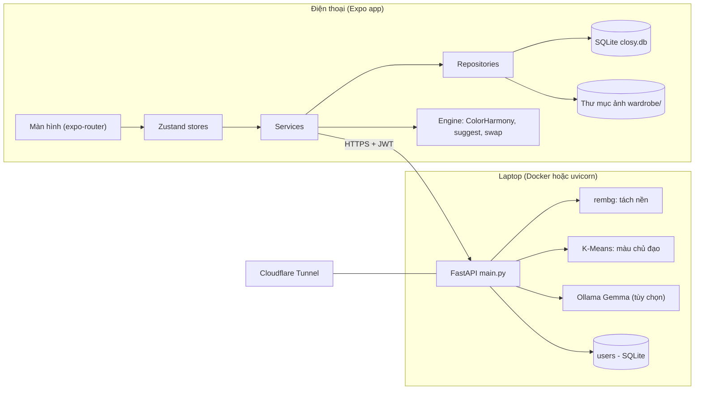

# 03. Kiến trúc

## 1. Bức tranh tổng thể



**Nguyên tắc:** phần lớn logic nằm ở **client**. Server chỉ giữ hai việc: tài khoản và xử lý ảnh.

| Dữ liệu | Nằm ở đâu | Gửi lên server? |
| :--- | :--- | :---: |
| Tủ đồ, lịch sử mặc, sự kiện | SQLite trên điện thoại | ❌ |
| Ảnh món đồ (đã tách nền) | Thư mục `wardrobe/` trên điện thoại | ❌ (chỉ gửi **một lần** để tách nền, server không lưu) |
| Việc tính gợi ý | Engine trên điện thoại | ❌ |
| Email, tên, mật khẩu băm | Server (`users`) | ✅ |
| JWT | SecureStore (Android) / localStorage (web) | — |
| Vị trí GPS | Dùng để hỏi thời tiết Open-Meteo, **không lưu** | Gửi tọa độ tới Open-Meteo |

## 2. Client (`client/`)

### Phân lớp (giữ đúng hướng gọi này)
```
UI (app/*.tsx)  →  Store (src/store)  →  Service (src/services)  →  Repository (src/repositories)  →  SQLite / file
                                     └→  Engine (src/engine, hàm thuần, có test)
```
Màn hình **không** gọi thẳng SQLite hay `fetch`. Hãy đi qua store hoặc service.

### Cấu trúc thư mục
| Đường dẫn | Việc |
| :--- | :--- |
| `app/_layout.tsx` | Gốc: mở DB, đọc phiên, điều hướng theo trạng thái đăng nhập, khai báo Stack |
| `app/(tabs)/_layout.tsx` | Thanh tab: today, wardrobe, suggest, history, insights |
| `app/*.tsx` | Các màn hình (xem bảng ở `01-Tong-quan.md`) |
| `src/api/client.ts` | `apiFetch`: gắn JWT, timeout 15 giây, tự đăng xuất khi server trả 401 |
| `src/api/endpoints.ts` | Khai báo kiểu và hàm gọi endpoint (`authApi`, `imageApi`, `outfitApi`) |
| `src/api/session.ts` | Lưu JWT (SecureStore trên native, localStorage trên web) |
| `src/store/authStore.ts` | Trạng thái đăng nhập: `loading` / `signedOut` / `signedIn` |
| `src/store/wardrobeStore.ts` | Danh sách món đồ, thêm/sửa/xóa |
| `src/services/AuthService.ts` | Google Sign-In, đăng nhập/đăng ký email |
| `src/services/ImageService.ts` | Nén ảnh ~800 px, gọi `/image/process` |
| `src/services/WardrobeService.ts` | Lưu ảnh + ghi SQLite |
| `src/services/OutfitService.ts` | Gọi engine, chọn tối đa 3 bộ đa dạng |
| `src/services/HistoryService.ts` | Xác nhận mặc, cập nhật `last_worn` và `wear_count` |
| `src/services/InsightService.ts` | Thống kê, đồ ít dùng, tủ còn thiếu gì |
| `src/services/EventService.ts` | Sự kiện quan trọng |
| `src/services/WeatherService.ts` | GPS + Open-Meteo, cache 20 phút |
| `src/repositories/` | `ItemRepository` (SQL), `FileRepository` (ảnh) |
| `src/engine/` | `ColorHarmonyEngine.ts`, `suggest.ts`, `swap.ts` |
| `src/db/` | Mở DB và `migrations.ts` |
| `src/constants/theme.ts` | Màu, khoảng cách, bo góc |
| `__tests__/` | Test Jest của engine và service |

### Các luồng quan trọng
- **Thêm món:** `add-item.tsx` → `ImageService.processClothingImage` (nén → `POST /image/process`) → màn hình điền sẵn thuộc tính → `wardrobeStore.addItem` → `WardrobeService.addItem` (lưu ảnh vào `wardrobe/`, ghi `items`). Server lỗi → giữ ảnh gốc (hiện **chưa có thông báo**, xem file 06).
- **Gợi ý:** `today.tsx`/`suggest.tsx` → `OutfitService.getSuggestions` → `generateOutfitSuggestions` (engine) → `pickDiverse` (tối đa 3 bộ).
- **Điều chỉnh:** `outfit-detail.tsx` → `swap.ts` (`swapOutfit`) giữ món khóa, ưu tiên bộ chưa xem.
- **Xác nhận mặc:** `HistoryService.confirmWear` ghi `history` và cập nhật các món trong **một transaction**.

## 3. Cơ sở dữ liệu trên điện thoại (SQLite `closy.db`)

Phiên bản lưu ở `PRAGMA user_version`. File: `client/src/db/migrations.ts`.

| Bảng | Từ | Cột chính |
| :--- | :-: | :--- |
| `items` | v1, v2 | `id`, `name`, `category` (`Áo`/`Quần`/`Váy`/`Đầm`/`Giày`), `image_path`, `color_h/s/l`, `color_hex`, `color_name`, `formality` (1/3/5), `contexts` (chuỗi `"Đi học,Đi làm"`), `last_worn`, `wear_count`, `created_at` |
| `history` | v3 | `id`, `worn_date` (`YYYY-MM-DD`), `context`, `item_ids` (`"1,2,3"`), `created_at` |
| `planned_events` | v4 | `id`, `date`, `type`, `note`, `context`, `remind_at` (chưa dùng), `created_at` |

**Quy tắc vàng:** chỉ **thêm** phần tử mới vào cuối mảng `MIGRATIONS`. Tuyệt đối không sửa phần tử cũ (máy đã chạy rồi sẽ không chạy lại).

## 4. Engine gợi ý (`client/src/engine/suggest.ts`)

Hàm thuần, không gọi mạng, có test ở `client/__tests__/`.

```
Tổng = 50 + Điểm bối cảnh (từng món) + Màu×10 + Đồng bộ + Thời tiết + Tái sử dụng
```

| Thành phần | Quy tắc |
| :--- | :--- |
| **Màu** (`ColorHarmonyEngine`) | Có màu trung tính (`S<15` hoặc `L<15` hoặc `L>88`) hoặc cùng tông (lệch H<35°): **+3**; tương phản (150–210°): **+2**; còn lại **−2** (xung đột). Bộ xung đột bị loại nếu còn bộ khác |
| **Bối cảnh** (`calculateItemContextScore`) | +45 nếu món gắn nhãn đúng bối cảnh; −25 nếu gắn nhãn khác; từ khóa trong tên (vd `sơ mi` cho đi làm); **trừ 8 điểm mỗi bậc** lệch so với mức mong muốn |
| **Mức mong muốn** (`targetFormality`) | Đi học 2, Đi chơi 2, Đi làm 3, Hẹn hò 3, Sự kiện 5 |
| **Đồng bộ** | Trừ **5 điểm mỗi bậc** chênh độ lịch sự giữa áo và quần |
| **Thời tiết** | Lạnh/mưa ưu tiên đồ ấm, dài; nóng ưu tiên đồ thoáng, màu sáng |
| **Tái sử dụng** | **+10** nếu có món ≥ 14 ngày chưa mặc, **chỉ khi** bộ đã đạt (điểm màu ≥ 2) |

- Đầm đi **một mình** (chỉ thêm giày), không kèm áo/quần.
- Giày chọn theo độ hợp màu với quần (hoặc đầm).
- Mỗi bộ có `reasons[]` hiển thị cho người dùng.
- Các con số trên là **giá trị khởi đầu**, chưa hiệu chỉnh bằng dữ liệu thật. Muốn chỉnh: sửa trong `suggest.ts` và cập nhật test.
- Chấm điểm vẫn dựa một phần vào **chuỗi trong tên món** ("khoác", "thun", "jeans"...). Tên món đặt lạ thì điểm có thể lệch.

## 5. Server (`server/`)

| File | Việc |
| :--- | :--- |
| `main.py` | Toàn bộ API |
| `color_extractor.py` | K-Means lấy màu chủ đạo, ghép với bảng 11 màu của app |
| `requirements.txt`, `requirements-dev.txt` | Thư viện chạy / test |
| `tests/` | pytest (`test_api`, `test_main`, `test_image_process`, `test_clothing_logic`, `test_outfit_suggest`) |
| `scripts/benchmark_process.py` | Đo thời gian tách nền |

### Endpoint

| Endpoint | Cần JWT | Việc |
| :--- | :-: | :--- |
| `GET /health` | ❌ | Kiểm tra sống |
| `POST /auth/register` | ❌ | Tạo tài khoản bằng email (mật khẩu ≥ 8 ký tự) |
| `POST /auth/login` | ❌ | Đăng nhập; sai quá 5 lần trong 5 phút → 429 |
| `POST /auth/google` | ❌ | Xác thực Google ID token; liên kết với tài khoản email nếu trùng email |
| `GET /me`, `PATCH /me` | ✅ | Xem / đổi tên |
| `POST /image/process` | ✅ | Nhận ảnh (JSON `image_base64` hoặc multipart `file`), trả ảnh đã tách nền (data URL), màu, danh mục, tên, độ lịch sự, dịp. Ảnh không phải trang phục → `success:false`, `is_clothing:false` |
| `POST /outfit/suggest` | ✅ | Gợi ý phối đồ phía server. **Client không còn gọi** (engine chạy trên máy). Giữ lại để tham khảo hoặc xóa |

### Bảo mật hiện có
- Mật khẩu: PBKDF2-SHA256, 210.000 vòng (vẫn đọc được hash cũ 100.000 vòng); so sánh bằng `hmac.compare_digest`.
- Giới hạn ảnh: 20 MB, tối đa 40 triệu điểm ảnh (chống decompression bomb).
- Rate-limit đăng nhập: **trong bộ nhớ**, mất khi khởi động lại server, chỉ đúng với một tiến trình.
- CORS: theo `ALLOWED_ORIGINS`, mặc định `*`.
- Ảnh xử lý hoàn toàn trong RAM, không ghi ra đĩa.

## 6. "Muốn đổi X thì sửa ở đâu?"

| Muốn... | Sửa |
| :--- | :--- |
| Đổi ngưỡng/trọng số gợi ý | `client/src/engine/suggest.ts` + test `client/__tests__/suggest.test.ts` |
| Đổi cách chấm màu | `client/src/engine/ColorHarmonyEngine.ts` |
| Đổi luật Khóa/Đổi | `client/src/engine/swap.ts` |
| Thêm cột vào món đồ | Migration mới + `types/item.ts` + `ItemRepository.ts` |
| Đổi màu chủ đạo, font, bo góc | `client/src/constants/theme.ts` |
| Đổi danh sách màu của app | `COLOR_PALETTE` trong `add-item.tsx`, `ItemDetailModal.tsx` và `server/color_extractor.py` (**3 chỗ phải khớp nhau**) |
| Đổi prompt nhận diện bằng AI | `classify_clothing_with_ollama` trong `server/main.py` |
| Đổi ngưỡng "ít dùng / cho đi" | Đầu file `client/src/services/InsightService.ts` |
| Đổi hạn token | `TOKEN_TTL` trong `server/main.py` |
