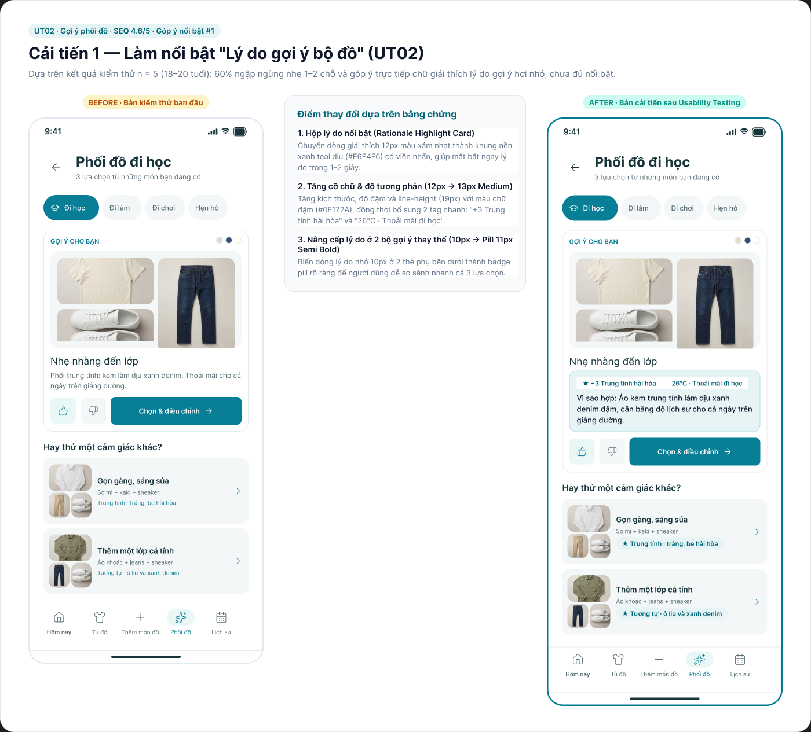
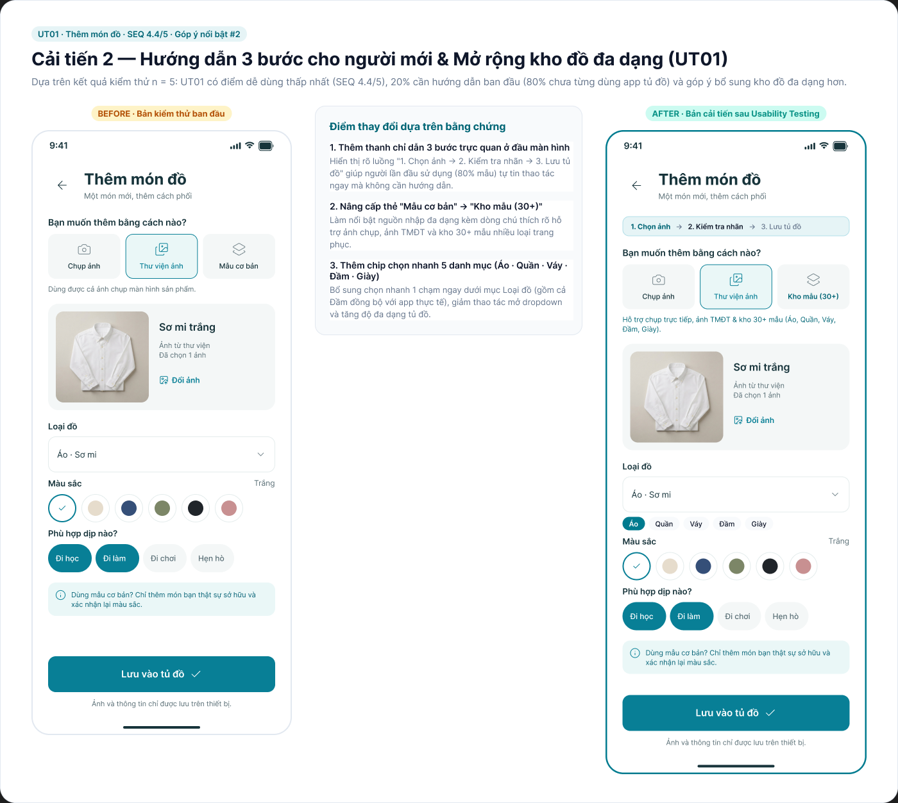

# Usability Testing Report — Closy Interactive Prototype

> **Môn học:** Phát triển Ứng dụng Di động – CO3043 (Tổ L01 – Nhóm L01 abc)  
> **Đối tượng kiểm thử:** Interactive Prototype trên Figma — [Xem Interactive Prototype](https://www.figma.com/proto/275uX1MaT8FUdPYXBMhre6/Untitled?node-id=2-5833&starting-point-node-id=2%3A5833) · [Xem trang Before / After trên Figma](https://www.figma.com/design/275uX1MaT8FUdPYXBMhre6/Untitled?node-id=76-2)  
> **Hình thức:** Kiểm thử tự thực hiện từ xa (*Unmoderated Remote Usability Testing*) qua Google Form ẩn danh + 3 luồng Figma Prototype  
> **Cỡ mẫu:** **5 người tham gia ngoài nhóm** (vượt mức tối thiểu 3 người; độ tuổi 18–20, 100% sinh viên đại học/cao đẳng, ẩn danh hoàn toàn)  
> **Trạng thái:** **Đã hoàn tất kiểm thử, phân tích & thực hiện 2 cải tiến thiết kế trên Figma (Before/After)**

---

## 1. Mục tiêu & Hồ sơ người tham gia (Ẩn danh)

### 1.1. Mục tiêu kiểm thử
Kiểm chứng khả năng sử dụng của 3 luồng cốt lõi MVP trên **Interactive Prototype** với người dùng thực tế ngoài nhóm (thuộc nhóm đối tượng mục tiêu 18–26 tuổi):
1. **UT01 — Nạp món đồ mới:** Đánh giá mức độ dễ hiểu và trơn tru khi người dùng lần đầu thêm trang phục vào tủ đồ số (liên kết Giả định **A2**).
2. **UT02 — Chọn bối cảnh & nhận gợi ý:** Đánh giá khả năng tìm bối cảnh, đọc hiểu lý do gợi ý và chọn bộ đồ nhanh chóng (liên kết Giả định **A3**).
3. **UT03 — Khóa/Đổi món & Xác nhận mặc:** Đánh giá độ trực quan khi phân biệt *Khóa món* vs *Đổi món* và mức độ rõ ràng của phản hồi sau khi lưu lịch sử mặc đồ (liên kết **US03, US04**).

### 1.2. Tổng quan đối tượng tham gia (`n = 5`, ẩn danh hoàn toàn)

| Chỉ số hồ sơ | Phân bố kết quả (n = 5) | Ghi nhận rút ra |
| :--- | :--- | :--- |
| **Độ tuổi & Nghề nghiệp** | **100% (5/5)** thuộc nhóm **18–20 tuổi**, là **Sinh viên đại học / cao đẳng**. | Khớp trực tiếp với nhóm đối tượng mục tiêu trọng tâm (18–26 tuổi). |
| **Thời gian chọn đồ buổi sáng** | • **Dưới 5 phút:** 60% (3/5) • **5–10 phút:** 40% (2/5) | Người dùng trẻ cần tốc độ chốt bộ thật nhanh; app không được tạo thêm bước thừa. |
| **Kinh nghiệm dùng app tủ đồ** | • **Chưa từng dùng:** 80% (4/5) • **Đã từng thử nhưng bỏ dùng:** 20% (1/5) | Phần lớn là người dùng mới hoàn toàn → màn hình nhập đồ ban đầu phải tự giải thích, không đòi hỏi học lại từ đầu. |

> **Cam kết ẩn danh & trung thực dữ liệu:** Toàn bộ 5 phản hồi đều đến từ người tham gia **ngoài nhóm** thông qua Google Form đã tắt chế độ thu thập email và không thu thập họ tên/MSSV. Số liệu dưới đây tổng hợp nguyên trạng từ bảng phản hồi thực tế.

---

## 2. Kịch bản 3 tác vụ đại diện MVP

| Mã tác vụ | Tình huống kiểm thử trên Google Form | Luồng màn hình trên Figma | Tiêu chí đánh giá |
| :-: | :--- | :--- | :--- |
| **UT01** | **Nạp món đồ mới:** Thêm một chiếc *áo sơ mi trắng* mới vào tủ đồ, kiểm tra loại đồ / màu sắc / dịp mặc và lưu lại. | `Tủ đồ của An` (`2:5913`) → `Thêm món đồ` (`2:6005`) → `Tủ đồ của An` | Tỷ lệ hoàn thành độc lập & điểm dễ dùng SEQ (1–5). |
| **UT02** | **Chọn bối cảnh & nhận gợi ý (< 20s):** Sáng thứ Hai chuẩn bị *đi học*, chọn bối cảnh phù hợp, đọc lý do gợi ý và mở chi tiết bộ ưng nhất. | `Hôm nay của bạn` (`2:5833`) → `Gợi ý phối đồ đi học` (`2:6086`) → `Điều chỉnh bộ đồ` | Tỷ lệ hoàn thành, mức độ hiểu rõ lý do gợi ý & điểm SEQ (1–5). |
| **UT03** | **Khóa/Đổi món & Xác nhận mặc:** Giữ nguyên *áo thun kem* yêu thích, đổi các món còn lại và bấm *Xác nhận mặc* để lưu lịch sử hôm nay. | `Điều chỉnh bộ đồ` (`2:6177`) → `Lịch sử mặc đồ` (`2:6260`) | Mức độ phân biệt Khóa vs Đổi, độ rõ phản hồi lưu lịch sử & điểm SEQ (1–5). |

*(Xem chi tiết kịch bản tại [TEST_SCRIPT_AND_SHEET.md](https://github.com/abc-Mobile-Group/Closy-Smart-Wardrobe-Intelligent-Outfit-Stylist/blob/NNam/Docs/UsabilityTesting/TEST_SCRIPT_AND_SHEET.md)).*

---

## 3. Kết quả kiểm thử định lượng (`n = 5`)

### 3.1. Tổng hợp kết quả qua 3 tác vụ MVP

| Tác vụ | Tỷ lệ / Mức độ hoàn thành | Điểm độ dễ (SEQ · 1–5) | Chỉ số phụ trợ & Vấn đề ghi nhận |
| :--- | :--- | :---: | :--- |
| **UT01 — Nạp món đồ mới** | • **60% (3/5)** hoàn thành dễ dàng • **20% (1/5)** ngập ngừng / bấm nhầm nhẹ • **20% (1/5)** cần hướng dẫn ban đầu | **4.4 / 5.0** | Điểm SEQ thấp nhất trong 3 tác vụ; 1 người dùng mới (trong nhóm 80% chưa từng dùng app tủ đồ) cần hướng dẫn ban đầu. |
| **UT02 — Chọn bối cảnh & xem gợi ý** | • **40% (2/5)** hoàn thành ngay lần bấm đầu • **60% (3/5)** ngập ngừng nhẹ 1–2 chỗ | **4.6 / 5.0** | **80% (4/5)** hiểu ngay lý do gợi ý; **20% (1/5)** phản hồi **chữ giải thích lý do gợi ý hơi nhỏ / chưa đủ nổi bật**. |
| **UT03 — Khóa/Đổi món & Xác nhận mặc** | • **80% (4/5)** hiểu ngay *Khóa món* & *Đổi món* • **20% (1/5)** phân vân nhẹ ban đầu | **4.6 / 5.0** | **100% (5/5)** xác nhận thấy rõ thông báo *"Đã lưu bộ đồ hôm nay"* ở Lịch sử. Không ghi nhận lỗi thao tác. |

### 3.2. Đánh giá tổng quan (Post-test)
- **Trải nghiệm tổng thể (Câu 5.1):** **100% (5/5 người)** đánh giá *"Cả 3 tác vụ đều mượt, không bị vướng nghiêm trọng"*.
- **Mức độ sẵn sàng dùng thử vào buổi sáng (Câu 5.2):** **4.8 / 5.0** (**4/5 người chấm 5/5**, **1/5 người chấm 4/5**).
- **Đề xuất cải thiện trực tiếp từ người dùng (Câu 5.3):**
  1. **Tăng kích thước phông chữ hoặc làm nổi bật hơn** phần giải thích *"Lý do vì sao ứng dụng gợi ý bộ đồ đó"*.
  2. **Bổ sung tính năng / kho dữ liệu nhập thêm nhiều món đồ mới đa dạng hơn**.

---

## 4. Phân tích điểm vướng mắc (Usability Issues)

| ID | Tác vụ / Màn hình | Mức độ | Tần suất | Mô tả vấn đề dựa trên bằng chứng | Nguyên nhân gốc trên thiết kế cũ | Quyết định cải tiến |
| :-: | :--- | :-: | :-: | :--- | :--- | :--- |
| **UI-01** | **UT02** / `Gợi ý phối đồ đi học` (`2:6086`) | **Major** | 3/5 ngập ngừng nhẹ; 1/5 góp ý trực tiếp (UT02 + Câu 5.3) | Người dùng đánh giá dòng giải thích lý do phối đồ **hơi nhỏ và chưa đủ nổi bật**, phải dừng lại đọc kỹ mới nhận ra cơ sở phối màu. | Dòng lý do chính dùng cỡ chữ **12px Regular** màu xám nhạt nằm lẫn dưới tiêu đề; lý do ở 2 thẻ phụ bên dưới chỉ **10px Regular**, thiếu nền/tag nhấn thị giác. | **Cải tiến 1 trên Figma:** Bọc hộp nổi bật (`#E6F4F6`), tăng cỡ chữ lên `13px Medium` đậm + gắn tag lý do nhanh (`+3 Trung tính`, `26°C`) và nâng 2 dòng phụ thành pill `11px Semi Bold`. |
| **UI-02** | **UT01** / `Thêm món đồ` (`2:6005`) | **Major** | 2/5 ngập ngừng hoặc cần hướng dẫn; góp ý trực tiếp ở Câu 5.3 | Tác vụ nhập đồ có **SEQ thấp nhất (4.4/5.0)**; 1/5 người dùng mới cần hướng dẫn ban đầu và người tham gia mong muốn có **kho dữ liệu/lựa chọn nhập nhiều món đa dạng hơn**. | 80% người dùng chưa từng dùng app tủ đồ nhưng màn hình thiếu chỉ dẫn bước ngắn gọn; nút *"Mẫu cơ bản"* không thể hiện sự đa dạng và danh mục chỉ ẩn trong 1 dropdown. | **Cải tiến 2 trên Figma:** Thêm thanh chỉ dẫn 3 bước (`1. Chọn ảnh → 2. Kiểm tra nhãn → 3. Lưu tủ đồ`), nâng cấp *"Mẫu cơ bản"* → **"Kho mẫu (30+)"** và thêm hàng chip chọn nhanh 5 danh mục (`Áo · Quần · Váy · Đầm · Giày`). |
| **UI-03** | **UT03** / `Điều chỉnh bộ đồ` (`2:6177`) | **Minor** | 1/5 phân vân nhẹ lúc đầu | 20% hơi dừng lại 1 nhịp trước khi phân biệt nút *Khóa* và *Đổi*, nhưng sau đó tự hiểu và 100% hoàn tất xác nhận mặc rõ ràng. | Trạng thái *Đã khóa* đã rõ nhưng vẫn có thể tiếp tục củng cố micro-copy ở giai đoạn sau. | **Theo dõi (Keep & Monitor):** Không cản trở luồng (SEQ 4.6/5.0, 0 lỗi thao tác). |

---

## 5. Cải tiến thiết kế trên Figma (Design Iteration — Before / After)

Toàn bộ 2 cải tiến được dựng thành trang riêng **`Usability Iteration (Before / After)`** (`Page 2`, node `76:2`) trên file Figma của nhóm để giữ nguyên bản gốc đối chiếu và lưu hình ảnh Before/After sắc nét:

### Cải tiến 1 — Làm nổi bật "Lý do gợi ý bộ đồ" (`UT02` · Màn `Gợi ý phối đồ đi học`)
- **Bằng chứng từ kiểm thử:** 60% người tham gia ngập ngừng nhẹ ở UT02; góp ý trực tiếp chỉ ra chữ giải thích lý do gợi ý nhỏ, chưa nổi bật (UT02 & Câu 5.3).
- **Các thay đổi cụ thể trên Figma:**
  1. Chuyển dòng giải thích `12px Regular` xám mờ thành **Hộp lý do nổi bật (`Highlighted Rationale Box`)** nền xanh teal dịu `#E6F4F6` có viền nhấn `#B2DFE8`.
  2. Tăng kích thước & độ tương phản văn bản lý do (**`12px Regular` → `13px Medium`, màu `#0F172A`, `line-height: 19px`**), bổ sung 2 tag quét nhanh: **`★ +3 Trung tính hài hòa`** và **`26°C · Thoải mái đi học`**.
  3. Nâng cấp lý do ở 2 thẻ gợi ý thay thế bên dưới từ dòng text `10px` thành **pill badge `11px Semi Bold`** trên nền `#E6F4F6`.

---

### Cải tiến 2 — Hướng dẫn 3 bước cho người mới & Mở rộng kho đồ đa dạng (`UT01` · Màn `Thêm món đồ`)
- **Bằng chứng từ kiểm thử:** UT01 có điểm SEQ thấp nhất (`4.4/5.0`), 20% cần hướng dẫn ban đầu, 20% ngập ngừng nhẹ (trong bối cảnh 80% chưa từng dùng app tủ đồ) và góp ý Câu 5.3 mong muốn kho nhập đồ đa dạng hơn.
- **Các thay đổi cụ thể trên Figma:**
  1. Bổ sung **Thanh chỉ dẫn nhanh 3 bước** (`1. Chọn ảnh → 2. Kiểm tra nhãn → 3. Lưu tủ đồ`) ngay đầu màn hình giúp người dùng mới nắm ngay luồng thao tác trong 1 giây.
  2. Nâng cấp thẻ *"Mẫu cơ bản"* thành **`Kho mẫu (30+)`** kèm chú thích nổi bật: *"Hỗ trợ chụp trực tiếp, ảnh TMĐT & kho 30+ mẫu (Áo, Quần, Váy, Đầm, Giày)"*.
  3. Thêm **hàng chip chọn nhanh 5 danh mục (`Áo`, `Quần`, `Váy`, `Đầm`, `Giày`)** ngay dưới ô *Loại đồ* để nhập đa dạng loại trang phục chỉ với 1 chạm (đồng bộ với mã nguồn app).

---

## 6. Kết luận & Cập nhật giả định sản phẩm

| Giả định (từ Mục 3 Wiki) | Kết luận sau Usability Testing (`n = 5`) | Hành động tiếp theo |
| :---: | :--- | :--- |
| **A2** *(Nạp đồ dễ dàng, ít công sức)* | **Đạt một phần — Đã cải tiến (SEQ 4.4/5.0):** 80% hoàn thành (60% dễ dàng, 20% ngập ngừng nhẹ), 20% người dùng lần đầu cần hướng dẫn. | Đã bổ sung **chỉ dẫn 3 bước + Kho mẫu 30+ + chip 5 danh mục** trên Figma (Cải tiến 2) để giảm rào cản cho người mới. |
| **A3** *(Gợi ý hữu ích, đúng gu & dễ chốt)* | **Đạt — Đã tối ưu hiển thị (SEQ 4.6/5.0; Willingness 4.8/5.0):** 100% hoàn thành UT02 & UT03, 80% hiểu ngay lý do gợi ý, 100% nhận biết rõ trạng thái lưu lịch sử. | Đã làm nổi bật **Hộp lý do gợi ý & tag màu/thời tiết** trên Figma (Cải tiến 1) để người dùng đọc lướt và chốt bộ nhanh hơn. |
