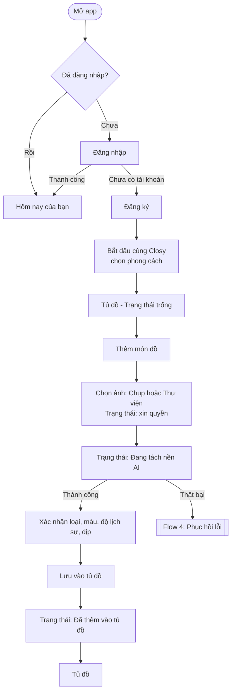
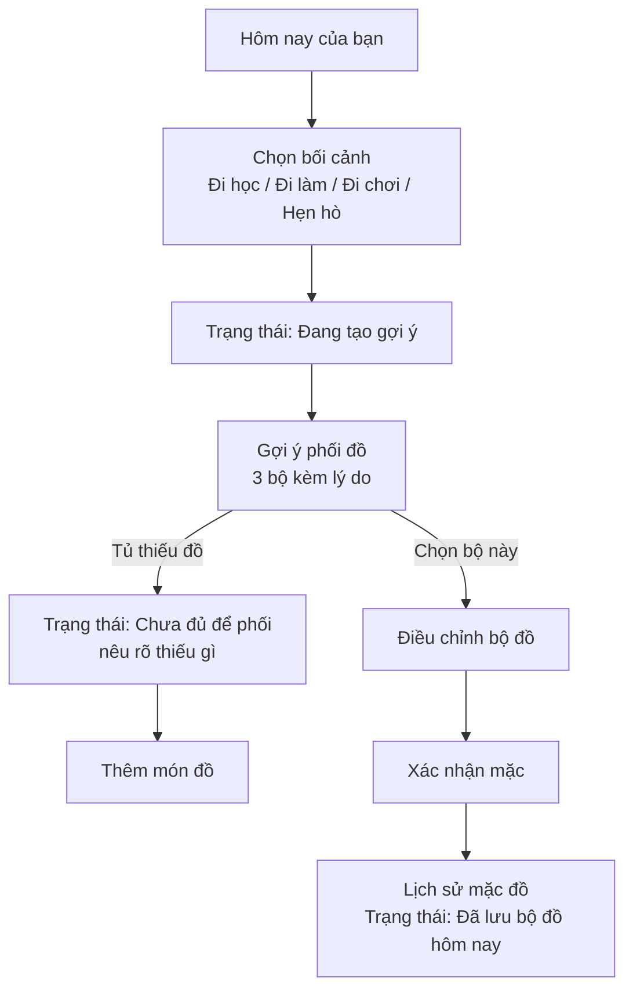
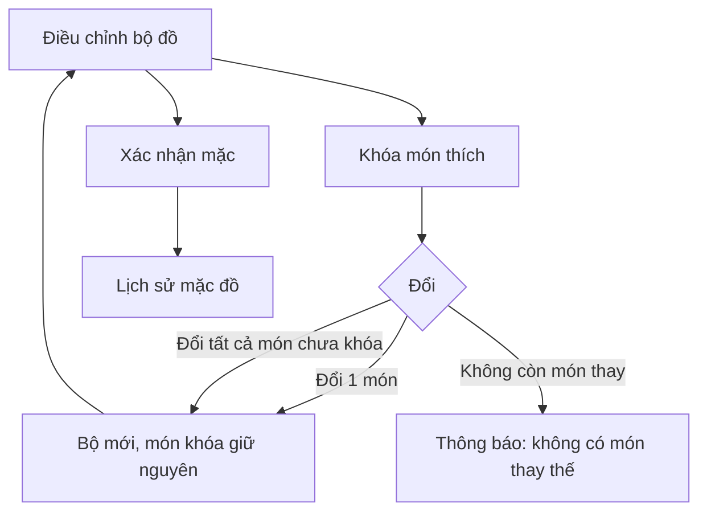
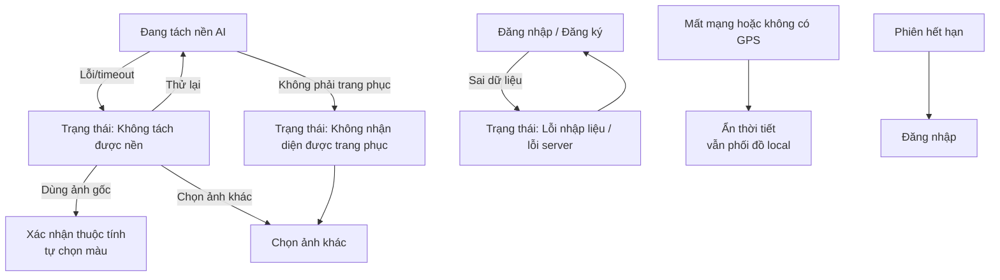
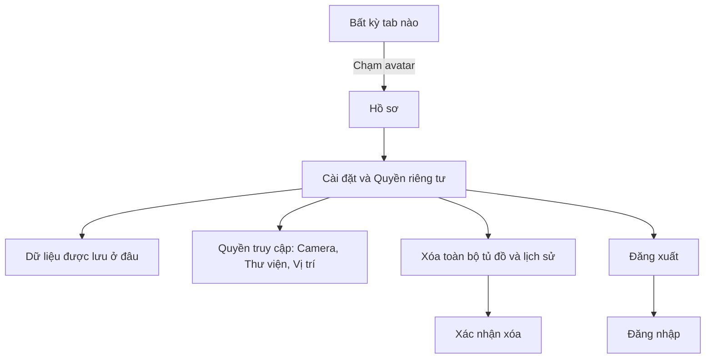

# 02. User Flows

Các flow dưới đây phải **khớp từng màn hình** với file Figma. Mỗi hộp là một màn hình hoặc một trạng thái; hộp có chữ "Trạng thái" cần có frame riêng trên Figma (xem `05-Edge-States-Spec.md`).

## Flow 1. Onboarding và nạp đồ

## Flow 2. Phối đồ nhanh (mục tiêu dưới 20 giây)

## Flow 3. Khóa / Đổi món và Xác nhận mặc

## Flow 4. Nhánh phục hồi lỗi

## Flow 5. Cài đặt và quyền riêng tư

## Bảng đối chiếu Flow ↔ Màn hình Figma
| Màn hình | F1 | F2 | F3 | F4 | F5 |
|---|:-:|:-:|:-:|:-:|:-:|
| Đăng ký | x | | | x | |
| Đăng nhập | x | | | x | x |
| Bắt đầu cùng Closy | x | | | | |
| Hôm nay của bạn | x | x | | x | x |
| Tủ đồ | x | | | | |
| Thêm món đồ | x | | | x | |
| Gợi ý phối đồ | | x | | | |
| Điều chỉnh bộ đồ | | x | x | | |
| Lịch sử mặc đồ | | x | x | | |
| Cài đặt & Quyền riêng tư | | | | | x |

> Cách dùng: mỗi dòng của bảng phải ứng với một frame tên trùng trên Figma. Frame nào có trên Figma mà không có trong bảng, hoặc ngược lại, là chỗ lệch cần sửa.
> Lưu ý nhỏ: trong code hiện tại nút của Onboarding đưa người dùng sang "Hôm nay" chứ không sang Tủ đồ trống. Nhóm chọn một cách và để Figma, Wiki, code cùng khớp.
